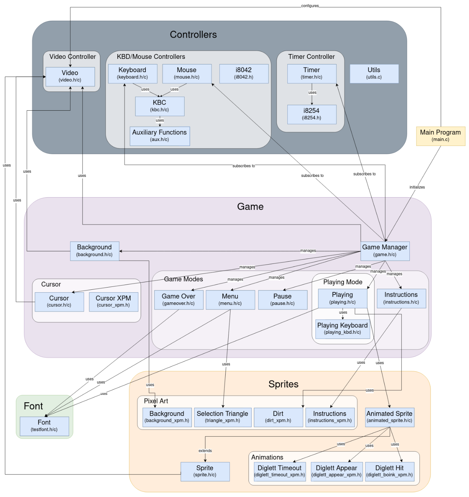

# Whack'a Diglett

A Minix-based whack-a-mole game with real-time graphics, keyboard and mouse input, and Diglett.

<p align="left">
  
  
</p>

## Table of Contents

- [Video Demo](#video-demo)
- [Project Overview](#project-overview)
    * [Game Features](#game-features)
    * [Report](#report)
- [System architecture](#system-architecture)
    * [Core Architecture Diagram](#core-architecture-diagram)
    * [Key Components](#key-components)
    * [Project Structure](#project-structure)
- [Building and Running the Project](#building-and-running-the-project)
    * [Prerequisites](#prerequisites)
    * [Compilation](#compilation)
    * [Running](#running)
- [Team & Course](#team--course)
- [Acknowledgements](#acknowledgments)

## Video Demo
<a href='https://uporto.cloud.panopto.eu/Panopto/Pages/Viewer.aspx?id=88df2542-6c0e-475b-951b-b2ef012c267f'>video demo</a>

## Project Overview

Whack'a Diglett is a 2D game built from scratch for the Minix operating system, featuring real-time graphics, user input handling, and smooth animations. The game challenges players to whack appearing Diglett characters within a time limit to achieve the highest score possible.

### Game Features

- **Multiple Game Modes**: Menu, gameplay, pause, instructions, and game over screens
- **Dual Input Support**: You can use either keyboard or mouse controls
- **Real-time Progress Tracking**: Dynamic time bar and score counter
- **Smooth Animations**: Triple buffering for flicker-free animation transitions
- **Randomized Gameplay**: Unpredictable Diglett appearances for engaging replay value

### Report
<a href="docs/Whack&apos;a_Diglett-report.pdf">report</a>

## System Architecture

### Core Architecture Diagram


### Key Components

#### Hardware Interaction Layer

- **Timer Controller**: Manages game timing, animation frames, and game duration (60Hz)
- **Keyboard Controller**: Processes player input for menu navigation and gameplay
- **Mouse Controller**: Provides alternative input method with real-time cursor tracking
- **Video Controller**: Handles drawing operations and buffer management

#### Game Logic Layer

- **Game Core**: Controls main loop and state machine
- **Mode Managers**: Handle specific behaviors for different game states
- **Diglett System**: Manages individual timing and state transitions for each Diglett

#### Visual Components

- **Sprites**: Both static and animated visual elements
- **Buffer Management**: Multi-buffer system for smooth rendering
- **UI Elements**: Score display, time bar, menus, and cursor

### Project Structure

```
proj/
├── src/
│   ├── main.c                 # Program entry point
│   ├── controllers/           # Hardware abstraction layer
│   │   ├── kbdmouse/         # Keyboard and mouse controllers
│   │   ├── timer/            # Timer controller
│   │   └── video/            # Video controller
│   ├── game/
│   │   ├── game.c/h          # Main game loop and state machine
│   │   ├── background.c/h    # Background management
│   │   ├── cursor/           # Cursor implementation
│   │   ├── modes/            # Game modes (menu, playing, etc.)
│   │   └── sprites/          # Sprite management
│   └── fonts/                # Text rendering
└── doc/                      # Documentation
```

## Building and Running the Project

### Prerequisites

- Minix 3.1.8
- LCOM development environment

### Compilation

```
$ cd labs/proj/src/
$ make clean && make
```

### Running

```
$ lcom_run proj
```

## Team & Course

**Team**

- <a href='https://github.com/franpts2'>Francisca Portugal</a>
- <a href='https://github.com/gab1demattos'>Gabriela de Mattos</a>
- <a href='https://github.com/maluviieira'>Maria Luiza Vieira</a>
- <a href='https://github.com/staragarcia'>Sara García</a>

**Course**

Developed for **LCOM (Laboratory of Computers)** at FEUP.

## Acknowledgments

- LCOM teaching staff at FEUP
- Minix operating system developers
- Pokémon franchise for the Diglett character inspiration

## License

Coursework submitted at FEUP. Shared for reference; all rights reserved unless stated otherwise.

---

_Whack'a Diglett — whack fast, score high._
